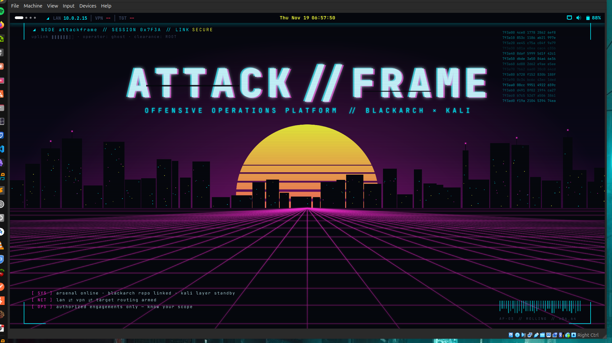
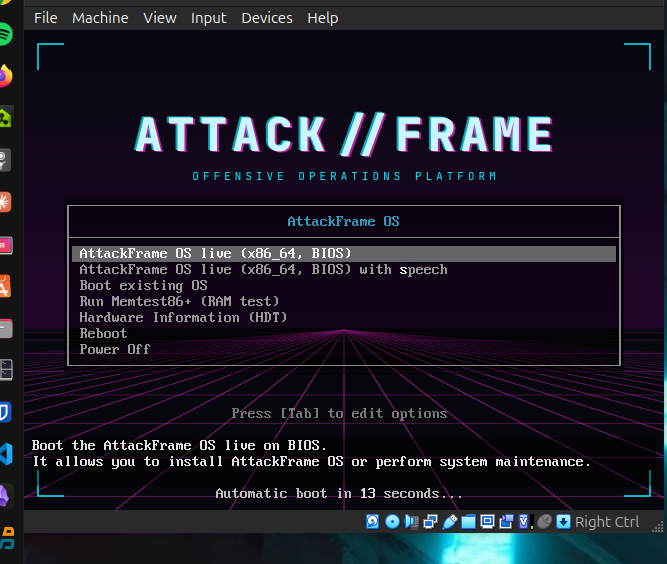
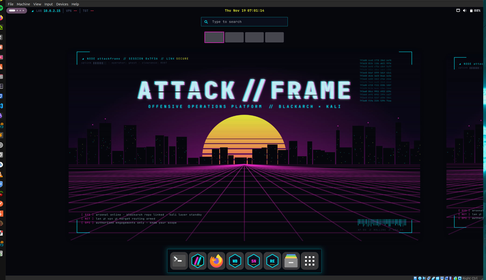
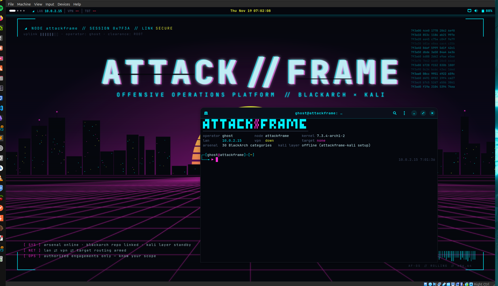
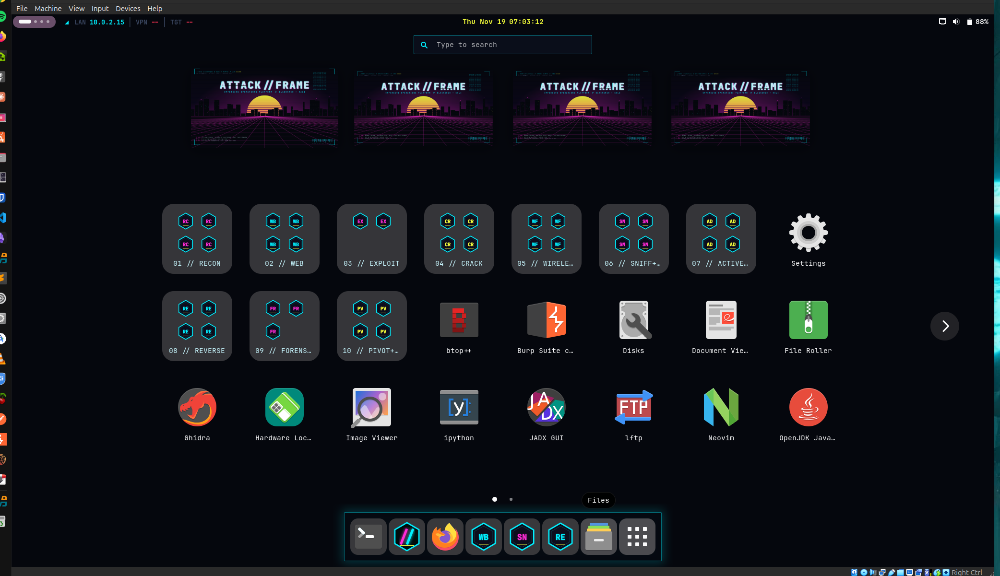
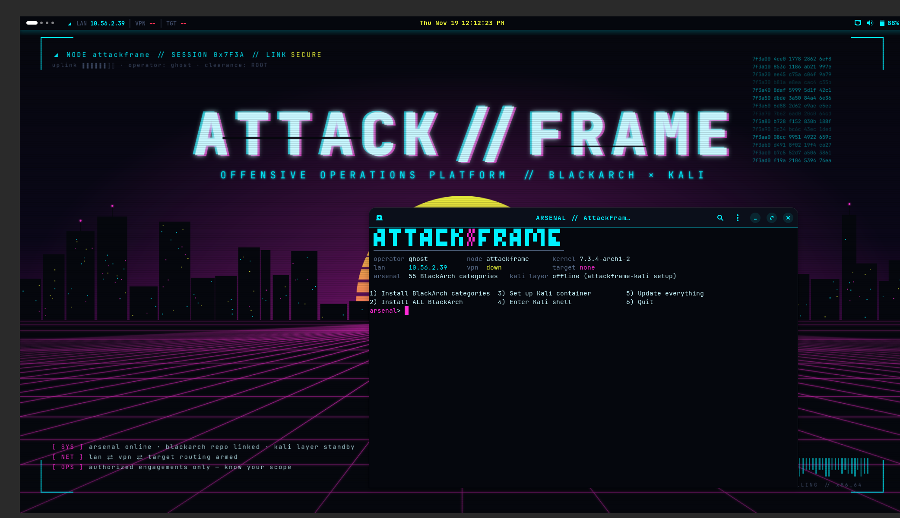

# AttackFrameOS - Kali Build

A cyberpunk penetration-testing distro: **Kali Linux** (kali-rolling) as the host OS with a neon-HUD **GNOME** desktop and the Kali toolset installed natively, plus the full **BlackArch** repository running alongside it as a **Docker** container. All artwork is original.

```
 ▄▀█ ▀█▀ ▀█▀ ▄▀█ █▀▀ █▄▀ ▞▞ █▀▀ █▀█ ▄▀█ █▀▄▀█ █▀▀
 █▀█  █   █  █▀█ █▄▄ █ █ ▞▞ █▀  █▀▄ █▀█ █ ▀ █ ██▄
```

## Why Kali + one container?

The Ubuntu edition kept a neutral host and put *both* tool distros in containers. Here Kali is the host, so its tools run natively — no container overhead, no shims, full hardware access for wireless and USB gear. BlackArch is Arch (`.pkg.tar.zst`/pacman) and can't share a Debian root without breaking each other's libraries, so it stays in its own box:

| Layer | Source | How | On the ISO |
| --- | --- | --- | --- |
| Host | **Kali** (`kali-rolling`) + GNOME | apt, Debian `live-boot` | desktop, drivers, firmware, Docker, distrobox |
| Kali tools | **kali-rolling** | native apt packages (`packages/kali-core.txt`) | curated core set, or `kali-linux-default` with `TOOLSET=large` |
| BlackArch | **Arch + BlackArch** (~2,800 tools, 50+ categories) | distrobox `blackarch` on Docker — host network, raw sockets, shared `$HOME`, display | curated core image, baked in |

The BlackArch image ships pre-built inside the ISO (`/usr/share/attackframe/images/blackarch.tar`) and is loaded into Docker the first time the box is created, so it works offline. Tools in `tools.tsv` that Kali doesn't have natively get a shim in `/usr/local/bin`, so `katana`, `sudo rustscan`, `dalfox` … work straight from the host shell and the app grid. A native Kali tool always wins over a BlackArch shim. Anything else in BlackArch: `blackarch <cmd>`.

## Build

Needs Docker with the Compose plugin (`sudo apt install docker.io docker-buildx docker-compose`), ~60 GB free disk, a few GB RAM, and a good connection. Works on any Linux host. `build.sh` uses your Docker daemon directly if you're in the `docker` group, otherwise it re-runs itself with sudo.

The build runs in a privileged Kali builder container (`kalilinux/kali-rolling`) defined in `docker-compose.yml` (`docker compose run --rm builder`). It debootstraps Kali, installs the desktop and tools, and uses your host's Docker daemon (socket mount) to build the BlackArch image, so it stays cached between builds.

```bash
./build.sh
```

| Variable | Default | Meaning |
| --- | --- | --- |
| `TOOLSET` | `core` | `minimal` = Kali desktop only, no BlackArch image (pulled on first use) · `core` = `kali-core.txt` + curated BlackArch image · `large` = + `kali-linux-default` + whole BlackArch groups in `BA_GROUPS` |
| `KALI_SUITE` | `kali-rolling` | Kali branch (`kali-last-snapshot` for the quarterly snapshot) |
| `KALI_MIRROR` | http://http.kali.org/kali | apt mirror |
| `KERNEL_PKG` | `linux-image-amd64` | kernel package |
| `KALI_META` | — | extra Kali metapackage(s) installed natively (e.g. `kali-tools-wireless`) |
| `BA_GROUPS` | recon webapp exploitation cracker wireless | groups used by `TOOLSET=large` |
| `STRAP_SHA1` | — | enforce BlackArch `strap.sh` checksum (published on blackarch.org/downloads) |
| `SQUASHFS_LEVEL` | `15` | zstd level for the root filesystem |
| `LIVE_PASSWORD` | `ghost` | password of the live user `ghost` (stored in the image as a SHA-512 hash) |

The ISO (`out/attackframe-kali-<date>-amd64.iso`) and its `.sha256` land in `out/`. Kali package names that vanish from the repo are skipped with a warning and listed on the system in `/usr/share/attackframe/kali-skipped.txt` (install failures in `kali-failed.txt`); in the BlackArch image they're logged to `/var/log/attackframe-skipped.txt`. Work files live in `.work/`, download caches in `.cache/kali-apt` and `.cache/kali-debootstrap` (all git-ignored).

Test it in a VM:

```bash
./scripts/test-iso.sh            # UEFI      (./scripts/test-iso.sh --bios for legacy)
```

**Secure Boot:** Kali's kernel isn't Secure Boot signed, so turn Secure Boot off in the firmware to boot the ISO or an installed system.

## Using it

The live session auto-logs in as **`ghost` / `ghost`** (password set by `LIVE_PASSWORD` at build time; passwordless sudo, in the `docker` and `wireshark` groups, live only). Boot menu options: normal, copy to RAM, persistence (a partition labelled `persistence` with a `persistence.conf` containing `/ union`), forensic (no swap, no automount), safe graphics.

On the live ISO Docker's storage lives in RAM, and the baked BlackArch image is copied into it the first time the box is used. Loading it briefly needs about twice its size in RAM. On a live USB, either give the machine plenty of RAM or let Docker use a disk instead:

```bash
# once: make a partition (on the boot USB's free space or any disk) and label it AF-DOCKER
sudo mkfs.ext4 -L AF-DOCKER /dev/sdX3
```

At boot, AttackFrame puts Docker's storage on a partition labelled `AF-DOCKER` when it finds one, so the image loads to disk and the box persists across live boots. An installed system doesn't need any of this.

| Command | What it does |
| --- | --- |
| `attackframe-arsenal menu` | interactive manager (also the **AttackFrame Arsenal** app) |
| `attackframe-arsenal status` | Kali (native) + BlackArch box state |
| `attackframe-arsenal install ba:webapp kali:tools-wireless katana` | install into either layer (bare names: BlackArch category → BlackArch, else Kali, else BlackArch) |
| `attackframe-kali setup` [core\|default\|large\|everything\|top10\|tools-*] | install Kali tool sets natively (wraps apt) |
| `attackframe-blackarch setup` [core\|&lt;category&gt;\|full] | create/extend the BlackArch box |
| `blackarch <tool>` / `blackarch` (`ba`) | run a BlackArch tool / open a BlackArch shell |
| `attackframe-blackarch export <bin>` | put any box binary on the host PATH |
| `attackframe-box sync` | re-index the box, rewrite shims + app-grid launchers |
| `target 10.10.11.5` | set the engagement target (shown in prompt + top-bar HUD, `$TGT`) |
| `lhost` | your VPN IP if a tunnel is up, else LAN IP (`$LHOST`) |
| `scan`, `fullscan` | nmap presets against `$TGT` |

Kali tools are just commands (`nmap`, `msfconsole`, `burpsuite` …). `sudo <tool>` on a BlackArch shim runs it as root inside the box (raw sockets, monitor mode, privileged ports).

### Install to disk

From the live session:

```bash
sudo attackframe-install /dev/sda --user ghost
```

Wipes the disk (GPT: BIOS-boot + 512 MiB EFI + ext4 root), copies the live system including the native Kali tools and the baked BlackArch image, removes live-boot, creates your user and installs GRUB for both UEFI and legacy BIOS. Your user is added to the `docker` group so the BlackArch box and its launchers work without a password prompt. Membership of `docker` is root-equivalent; add `--no-docker-group` to leave it out, in which case the box runs through sudo.

## The look

-   **Palette** — void `#05070d`, cyan `#00f0ff`, magenta `#ff2bd6`, yellow `#f5ff3b`, ice `#c8f7ff`
-   **Shell theme** — built at boot from the stock GNOME dark theme + `overrides.css` (rebuilt by an apt hook after GNOME upgrades)
-   **HUD extension** — top bar shows `◢ LAN │ VPN │ TGT`, click to copy any of them
-   **App grid** — tools grouped into folders `01 // RECON` … `10 // PIVOT+C2` with hex icons; each launcher notes whether it's native Kali or BlackArch
-   **Terminal** — neon gnome-terminal profile, JetBrains Mono Nerd Font, operator prompt + banner showing Kali and the BlackArch box
-   **Boot** — AttackFrame GRUB splash and plymouth theme
-   **GTK** — libadwaita/adw-gtk3 recoloured to match; Papirus-Dark icons; neon-framed overview dash

## Layout

```
build.sh                       host entry point (checks Docker, runs the builder via Docker Compose)
docker-compose.yml             the privileged Kali builder service
scripts/build-in-container.sh  debootstrap Kali + live-boot rootfs, native tools, BlackArch image, squashfs, hybrid GRUB ISO
scripts/test-iso.sh            boot the ISO / installed disk in QEMU
containers/blackarch/Containerfile  Arch + BlackArch (strap.sh) layer image
packages/base.txt              Kali base / live / firmware / installer packages
packages/desktop.txt           GNOME desktop + shell tools
packages/kali-core.txt         Kali tools installed natively
packages/blackarch-core.txt    tools baked into the BlackArch image
scripts/gen-assets.py          regenerates assets/*.svg
scripts/gen-wallpapers{,2,3}.py  regenerate the 50-wallpaper pack
scripts/render-wallpapers.sh   renders the pack to 4K PNGs in assets/wallpapers/png/
assets/                        wallpaper, boot splash, icons (SVG sources)
profile/airootfs/              files overlaid on the Kali root filesystem
```

Use only on systems you own or are authorised to test.

## Console

The console gives you Kali natively and BlackArch in a box on the same instance. BlackArch has some interesting tools that Kali does not have.












